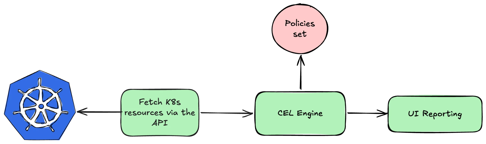

# kscan

A Kubernetes security scanner written in Go. It reads your cluster through the Kubernetes API, checks it with **CEL policies** mapped to [MITRE ATT&CK](https://attack.mitre.org/matrices/enterprise/containers/) and the [Kubernetes Threat Matrix](https://kubernetes-threat-matrix.redguard.ch/), and shows every finding with the the fixed YAML to apply it (based on business needs)

https://github.com/user-attachments/assets/949390e0-9e61-4d92-8d2b-859f52b75a0d

## 1. Top 3 features ideas

**Policies written in CEL.** Every check is a  YAML file with a CEL expression. I picked CEL because Kubernetes already uses it for ValidatingAdmissionPolicy and CRD validation, so most people working with Kubernetes can read it. It also servers as the backbone for known policy engines like Kyverno and KubeWarden. Custom policies live in a ConfigMap and are reloaded on every scan which makes it portable and not dependend on application code.

Each policy is tagged with the MITRE ATT&CK (Containers) technique it relates to, plus the matching entry in the Kubernetes Threat Matrix. Those IDs are checked against a copy of both matrices when the policies load, so nobody can invent their own.

**Strong focus on RBAC.** In almost every attack in Kubernetes world, there is some form of using leaked ServiceAccount tokens that have to much permissions. Therefore, i want to make a strong focus on RBAC. Kscan looks at RoleBindings and ClusterRoleBindings, resolves the role behind each one, and reports what the subject can actually do, e.g. "ServiceAccount ci-bot can exec into pods in vuln-demo via Role debugger". It flags cluster-admin style grants, bindings to `system:authenticated` or anonymous users, and the usual escalation paths: reading secrets, exec into pods, creating workloads, and escalate/bind/impersonate.

**Every finding comes with a (proposed) fix.** For each finding the UI shows the offending YAML, the corrected YAML and the `kubectl` command to apply it.  RBAC fixes patch the Role and only remove the risky verb, and bindings that need a different role are replaced, because `roleRef` can't be changed. Findings should always be validated by the teams themselves as kscan doesn't have the context of what the application need in order to run (sometimes containers do need to run as root unfortunaly)

## 2. How I built it



It's written in Go , using `client-go` to talk to the K8s cluster (I think Go has the best K8s package to use compared to others) and `cel-go`, the same CEL library the API server uses. The result is a single binary in a small distroless image that runs as non-root.

The scanner runs as a Deployment with its own ServiceAccount. Its ClusterRole is read-only and deliberately has no access to Secrets or ConfigMaps. Every two minutes (as per demo env), or when you press Rescan, it lists 16 resource types from the API, runs the policies over them and keeps the result in memory. The same pod serves the web UI and a JSON endpoint (`/api/report`).

Installing is `kubectl apply -k deploy/`. To test it there's a kind playground with one deliberately broken namespace and one hardened one, you can also deploy the playground apart from the kscan deployment. The tests expect exactly 3 critical and 2 high findings on the broken one and nothing on the hardened one.

## 3. Approach

A scanner that dumps hundreds of findings without proper prioritization is worthless. Every finding should have a context aware severity score attached to it with proven 'exploit'. I'm also a firm believer in Policies as Code which you can directly apply since we are using CEL to get that secure-by-design in place.

1. **Context aware findings.** I want to further explore the findings to add the code-to-cloud context. If a misconfiguration (like container run as root), i would like to add the RBAC context to that (e.g. pods/exec create permission), the networking context (publically exposed service) and the data context as well (access to sensitive PII data). Combining these different vectors will give the finding a whole different severity instead of the standalone finding itself.
2. **Proof the misconfig.** if the consumer wants to, i'd like to add a functionality to validate the misconfiguration by 'hacking' it. We can make predefined attack for different type of misconfigs where customers could see the impact if not properly remediated. E.g. ServiceAccount token with node/proxy permission that serves an application that has a command injection vulnerability. (Build the exploit as validation step - https://grahamhelton.com/blog/nodes-proxy-rce)
3. **Prevent instead of detect.** Because the policies are CEL, they can be exported as ValidatingAdmissionPolicies, Kscan reports them in audit mode but when a consumer finds that there are 0 findings on a specific policy, they can implement the AdmissionPolicy to prevent it from ever happening again.


# Demo playground

Requires Docker, [kind](https://kind.sigs.k8s.io/), kubectl and Go 1.23+.

```bash
make playground-up
```

This creates a kind cluster with a deliberately vulnerable namespace (`vuln-demo`) and a hardened one (`secure-demo`), then builds kscan and deploys it. Open the UI:

```bash
make playground-ui
```

Go to http://localhost:8080 and click the cluster. You should see **3 critical and 2 high** findings; click one to see the found and fix YAML. Remove everything with `make playground-down`.

# Manual configuration 

## Build the container

```bash
docker build -t kscan:dev .
```

For a real cluster, tag and push it to a registry your nodes can pull from, then set `images:` in [deploy/kustomization.yaml](deploy/kustomization.yaml) to that image.

## Deploy the demo infrastructure (optional)

To try kscan without the Makefile, you can deploy the demo workloads yourself before installing the scanner. If you don't have a test cluster, create one with kind:

```bash
kind create cluster --config playground/kind-config.yaml
```

Then deploy the demo namespaces. Only do this on a throwaway cluster: `vuln-demo` contains a privileged DaemonSet, a cluster-admin binding and a binding that lets every authenticated user view the cluster.

```bash
kubectl apply -f playground/vulnerable -f playground/secure
```

| Namespace | What's in it | Expected findings |
|---|---|---|
| `vuln-demo` | a privileged log collector with a hostPath mount, a CI account that can exec into pods, plus two cluster-wide bindings (cluster-admin for one user, `view` for everyone) | 3 critical, 2 high |
| `secure-demo` | a hardened nginx with non-root user, read-only filesystem and NetworkPolicies | none |


## Install on your own cluster

On the kind cluster from the previous step, load the image you built first (on other clusters, push it to a registry as described above):

```bash
kind load docker-image kscan:dev --name kscan-playground
```

```bash
kubectl apply -k deploy/
```

```bash
kubectl -n kscan port-forward svc/kscan 8080:8080
```

Without a port-forward, you can read the results with kubectl alone:

```bash
kubectl get --raw "/api/v1/namespaces/kscan/services/kscan:http/proxy/api/report"
```

## Add your own policy

Add a YAML file to [deploy/custom-policies/](deploy/custom-policies/), then run `kubectl apply -k deploy/`. The next scan picks it up. [org-policies.yaml](deploy/custom-policies/org-policies.yaml) is a complete example; `tactic`, `mitre` and `threatMatrix` must reference real ATT&CK / Threat Matrix entries, or the policy is rejected.
